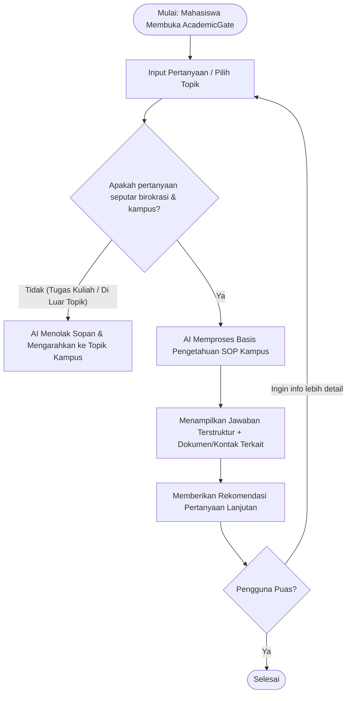

# 🎓 AcademicGate
> **Platform Asisten Cerdas & Pusat Informasi Birokrasi Kampus Terpadu**

---

## 📌 Executive Summary (Ringkasan Eksekutif)

Banyak mahasiswa—khususnya mahasiswa baru maupun mahasiswa tingkat lanjut—mengalami kesulitan dan kebingungan dalam menavigasi birokrasi kampus, seperti:
- Prosedur pembayaran Uang Kuliah Tunggal (UKT) dan pengajuan keringanan.
- Alur pendaftaran serta persyaratan beasiswa dan magang (internship).
- Prosedur administrasi skripsi, seminar proposal, hingga yudisium.
- Tata cara pengajuan proposal Unit Kegiatan Mahasiswa (UKM), perizinan kegiatan, hingga pencairan dana.
- Informasi umum seputar organisasi kampus (daftar UKM, rekam jejak kegiatan, dan prestasi kampus).

**AcademicGate** hadir sebagai solusi berbasis *Artificial Intelligence* (AI) dan *Knowledge Base* interaktif yang mempermudah mahasiswa mendapatkan informasi birokrasi secara cepat, tepat, dan transparan selama 24/7 tanpa harus mengantre atau membebani staf kampus yang sedang sibuk.

---

## 🏛️ Background & Context (Latar Belakang & Konteks)

Dalam lingkungan perguruan tinggi (seperti Universitas Darma Persada / UNSADA), dinamika informasi administrasi sering kali tersebar di berbagai saluran terpisah (website fakultas, papan pengumuman fisik, grup percakapan, atau akun media sosial yang tidak terpusat). Akibatnya:
1. **Disparitas Informasi**: Mahasiswa baru kebingungan mencari titik awal kontak resmi (harus ke BAAK, BAU, Prodi, atau Kemahasiswaan).
2. **Keterbatasan Jam Pelayanan**: Layanan administrasi tatap muka memiliki jam operasional terbatas, sedangkan mahasiswa kerap membutuhkan informasi di luar jam kerja.
3. **Beban Kerja Staf Administrasi**: Staf dan dosen sering kali harus menjawab pertanyaan berulang (FAQ dasar) yang menghabiskan waktu kerja substantif.
4. **Organisasi Mahasiswa Terhambat**: Pengurus UKM sering kali tertahan birokrasi proposal (salah format, salah tujuan tanda tangan, atau keterlambatan verifikasi) karena ketidaktahuan alur resmi.

---

## 🎯 Problem Statement (Pernyataan Masalah)

> *"Mahasiswa sering kali mengalami disinformasi dan keterlambatan pengurusan administrasi penting karena proses verifikasi informasi harus dilakukan secara manual kepada staf atau senior yang memiliki kesibukan tinggi, sehingga memperlambat proses akademik dan non-akademik."*

---

## ⚖️ Goals & Non-Goals

### ✅ Goals (Tujuan Utama)
- **Akses Cepat 24/7**: Mahasiswa dapat mengakses informasi birokrasi dan administrasi kapan saja dan di mana saja.
- **Jawaban Presisi & Terstruktur**: Memberikan panduan langkah-demi-langkah (step-by-step), persyaratan berkas, formulir terkait, serta lokasi/kontak unit kerja tujuan.
- **Sentralisasi Informasi UKM & Kampus**: Menyediakan direktori UKM, program kerja, tata cara bergabung, serta rekam jejak prestasi kampus.
- **Efisiensi Kerja Staf Kampus**: Mengurangi beban pertanyaan berulang pada bagian BAAK, BAU, dan Bagian Kemahasiswaan melalui asisten AI cerdas.
- **Rekomendasi Cerdas**: AI secara proaktif memberikan saran pertanyaan terkait (*smart follow-up suggestions*) untuk melengkapi pemahaman mahasiswa.

### 🚫 Non-Goals (Batasan Cakupan)
- **Bukan Penjawab Tugas Akademik (Homework/Code Solver)**: Sistem menolak perintah untuk mengerjakan soal ujian, tugas kuliah, ataupun penulisan esai/skripsi.
- **Bukan Pengganti Otoritas Resmi (No Direct System Modification)**: Sistem tidak secara otomatis menyetujui transaksi keuangan, memvalidasi KRS, atau menandatangani dokumen secara sepihak tanpa campur tangan birokrasi resmi.
- **Bukan Saluran Aduan Darurat**: Tidak ditujukan untuk layanan darurat medis atau kekerasan kampus (akan diarahkan langsung ke hotline khusus/satgas terkait).

---

## 👥 Target Audience & Personas

### 1. Target Audience
- **Mahasiswa Baru**: Membutuhkan orientasi sistem kampus, alur pembayaran, dan pengenalan organisasi mahasiswa.
- **Mahasiswa Aktif**: Membutuhkan kepastian alur magang, beasiswa, dan pengajuan proposal kegiatan.
- **Mahasiswa Tingkat Akhir**: Memerlukan panduan pendaftaran sidang, alur bebas pustaka, dan yudisium.
- **Calon Mahasiswa**: Ingin mengetahui profil kampus, program studi, fasilitas, dan kegiatan kemahasiswaan.

### 2. User Personas

| Persona | Profil & Kebutuhan | Pain Points (Kendala) |
|---|---|---|
| **Dimas (Mahasiswa Baru)** | Baru masuk semester 1, belum familiar dengan portal akademik dan alur pembayaran UKT via virtual account. | Takut salah transfer, malu bertanya ke kakak tingkat, loket BAU antre panjang. |
| **Sarah (Ketua UKM)** | Pengurus organisasi mahasiswa yang ingin menyelenggarakan festival seni kampus. | Bingung urutan persetujuan proposal (Pembina ➡️ BEM ➡️ Kemahasiswaan ➡️ Rektorat), format dokumen sering salah. |
| **Budi (Mahasiswa Semester Akhir)** | Sedang mempersiapkan berkas pendaftaran sidang skripsi dan beasiswa riset. | Informasi syarat berkas tercecer di beberapa pengumuman berbeda, batas waktu mepet. |
| **Ibu Ratna (Staf Administrasi Kampus)** | Staf front office BAAK/Kemahasiswaan. | Setiap awal semester kewalahan menjawab ratusan pertanyaan serupa berulang kali. |

---

## 🗺️ User Journey & User Stories

### 1. User Journey Flow

---

### 2. User Stories & Acceptance Criteria

#### 📋 Epic 1: Layanan Tanya Jawab Administrasi & Birokrasi
* **Story**: Sebagai **Mahasiswa**, saya ingin menanyakan syarat dan alur pengajuan beasiswa/UKT kepada AI, sehingga saya tidak perlu mengantre di loket kampus.
  * **Kriteria Penerimaan (Acceptance Criteria)**:
    * Sistem membalas pertanyaan dalam waktu < 3 detik.
    * Jawaban menyertakan: Persyaratan berkas, link download formulir (jika ada), ruangan/gedung unit kerja, dan tenggat waktu.

#### 📋 Epic 2: Pengajuan & Prosedur Proposal UKM
* **Story**: Sebagai **Pengurus UKM**, saya ingin menanyakan alur pengajuan proposal kegiatan kampus, sehingga proposal saya tidak ditolak karena salah alur disposisi.
  * **Kriteria Penerimaan (Acceptance Criteria)**:
    * Sistem menampilkan bagan/tahapan alur pengesahan dari pembina hingga biro kemahasiswaan.
    * Menyediakan contoh template format proposal resmi kampus.

#### 📋 Epic 3: Informasi Direktori & Prestasi Kampus
* **Story**: Sebagai **Mahasiswa Baru / Calon Mahasiswa**, saya ingin melihat daftar UKM dan rekam jejak kegiatan kampus, sehingga saya bisa memilih kegiatan yang sesuai minat saya.
  * **Kriteria Penerimaan (Acceptance Criteria)**:
    * Sistem menyediakan pencarian UKM berdasarkan kategori (Seni, Olahraga, Penalaran, Keagamaan).
    * Menampilkan deskripsi singkat, kontak media sosial resmi, dan prestasi yang pernah diraih.

#### 📋 Epic 4: Guardrail & Filter Pertanyaan Non-Goals
* **Story**: Sebagai **Sistem Kampus**, sistem harus menolak permintaan yang berkaitan dengan pengerjaan tugas atau materi ujian, sehingga integritas akademik tetap terjaga.
  * **Kriteria Penerimaan (Acceptance Criteria)**:
    * Pertanyaan seperti *"Tolong buatkan kode program tugas"* atau *"Jawab soal UTS ini"* akan dibalas dengan pesan penolakan yang ramah serta mengedukasi fungsi platform.

---

## 💡 Arsitektur Solusi & Fitur Rekomendasi

1. **RAG-based AI Engine (Retrieval-Augmented Generation)**:
   - Mengambil data resmi dari Buku Pedoman Akademik, SOP Kemahasiswaan, dan SK Rektorat untuk memastikan jawaban akurat dan anti-halusinasi.
2. **Knowledge Hub & Download Center**:
   - Repository template surat izin kegiatan, template proposal UKM, dan surat permohonan dispensasi.
3. **Smart Follow-up Suggestions**:
   - Setelah menjawab pertanyaan utama, AI otomatis memberikan 2-3 tombol opsi pertanyaan lanjutan yang relevan.
4. **Admin Escalation / Helpdesk Link**:
   - Jika pertanyaan bersifat kasus khusus (misal: verifikasi pembayaran gagal manual), sistem menyediakan kontak WhatsApp / Loket BAAK langsung.

---

## 🚀 Tahapan Pengembangan (Roadmap)

- [ ] **Fase 1 (Inisiasi & Riset Data)**: Pengumpulan dokumen SOP, regulasi akademik, kalender kampus, dan profil UKM UNSADA.
- [ ] **Fase 2 (Knowledge Base & MVP Chatbot)**: Pengembangan basis data terindeks vektor dan antarmuka web interaktif.
- [ ] **Fase 3 (Pengujian & Guardrail)**: Uji coba akurasi jawaban, evaluasi persona mahasiswa, dan penguatan filter non-goals.
- [ ] **Fase 4 (Deployment & Integrasi)**: Peluncuran ke lingkungan mahasiswa dan pengumpulan feedback pengguna.
